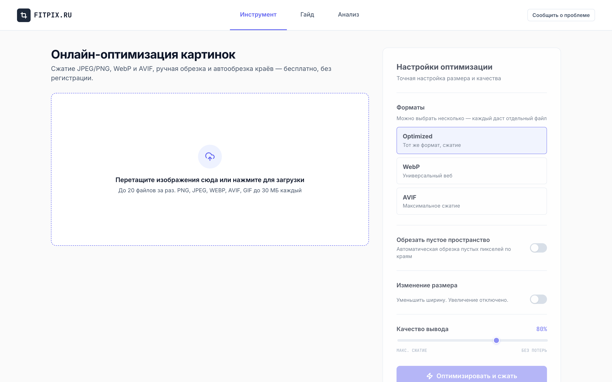
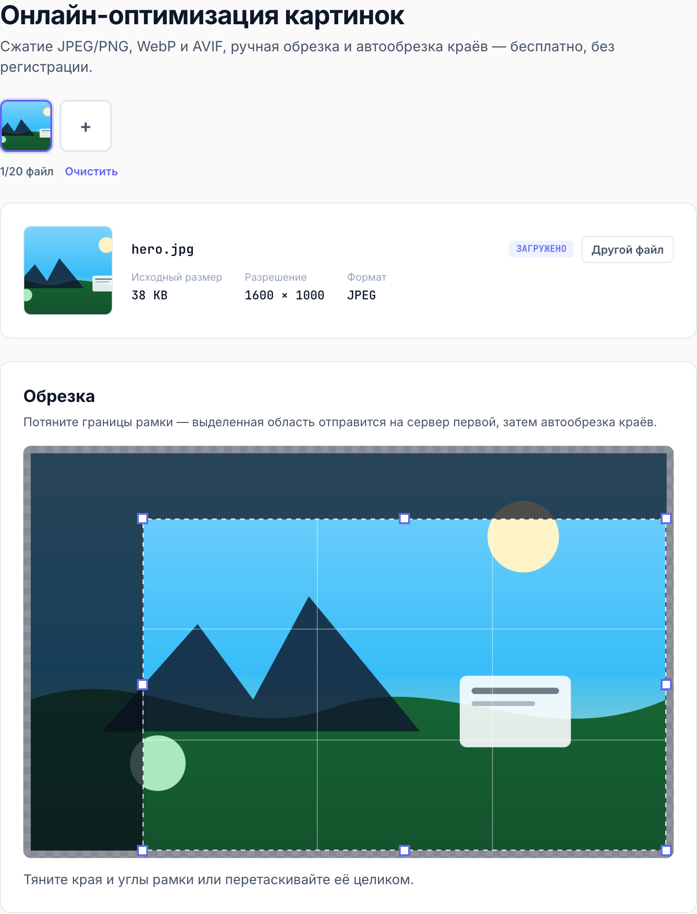
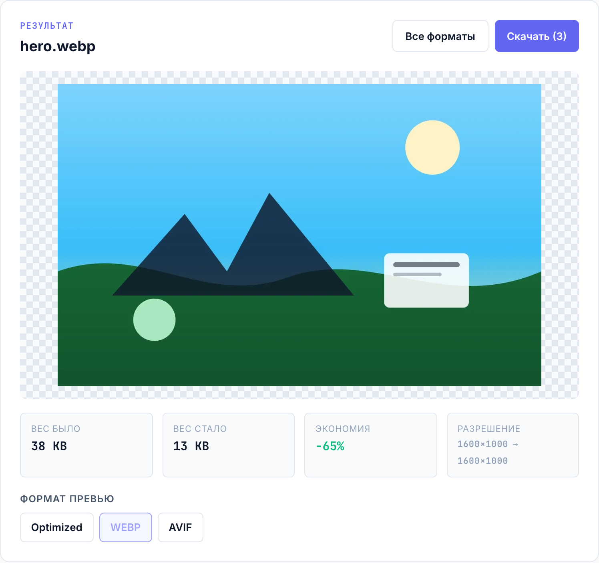
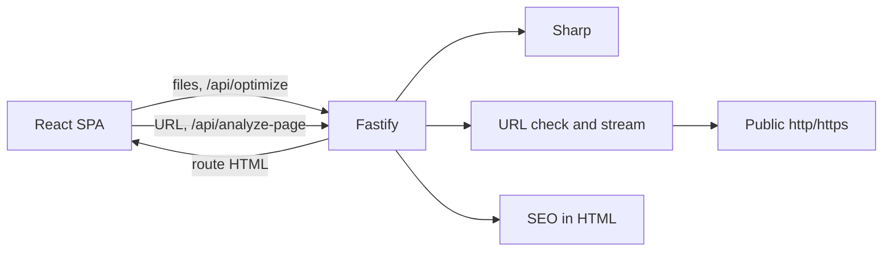

# Fitpix

[Русская версия](README.ru.md)

[](https://github.com/mhateb/images-helper/actions/workflows/ci.yml)
[](https://fitpix.ru)

Image optimization for the web. Live demo: **[fitpix.ru](https://fitpix.ru)**

Fitpix turns a heavy design export into a file you can put in a layout:

- a queue of up to 20 images;
- a crop in the source image's pixels;
- JPEG and PNG compression, conversion to WebP and AVIF, with the byte savings shown;
- analysis of someone else's page by URL: the service reads the HTML, finds the images, and estimates what they weigh and what you can save;
- a guide to `<picture>` at the 768, 1024, and 1280 breakpoints.

No account. The file lives in the request memory and leaves in the response. There is no database.

The interface is in Russian. Deployment, analytics, and API notes are in Russian too: [deploy](docs/deploy.md), [analytics](docs/analytics.md), [HTTP API](docs/api.md).

## Lighthouse

Lighthouse 12.8.2, mobile preset, local production build (Fastify serving `client/dist`, Brotli):

| Category | Score |
|----------|-------|
| Performance | 99 |
| Accessibility | 100 |
| Best Practices | 100 |
| SEO | 100 |

FCP 1.4 s, LCP 1.9 s, Speed Index 1.4 s, TBT 0 ms, CLS 0. axe-core reported no violations on `/`, `/guide`, `/analyze`, `/privacy`, or the bug-report dialog. The home page was checked in light and dark, and with `prefers-reduced-motion`.

The crop region is a named group: arrow keys move it, Shift and arrows resize it. The dropzone is a file input inside its label. The bug-report dialog moves focus in, traps Tab, and restores focus on close. Text colors meet WCAG AA. The UI follows `prefers-color-scheme` and turns entrance animations off when motion is reduced. A web app manifest (192 and 512 icons) and a service worker are included; HTML is not cached, because each document carries a one-time CSP nonce. The first paint uses the system UI font, so it does not wait on a third-party stylesheet.

## What it looks like

Upload, crop, and the result are the main path. The fourth frame is a Wikipedia article about JPEG: the HTML had 71 images, and the estimate used the first 40.








## Stack

| Part | Choice | Why |
|------|--------|-----|
| Images | [Sharp](https://sharp.pixelplumbing.com/) (libvips) | Crop, trim, resize, WebP, and AVIF in one process, without a separate encode service |
| API and HTML | [Fastify](https://fastify.dev/) | Multipart, static files, and SEO substitution share one listener. In production that is the only process |
| UI | React 19 and Vite | Crop and queue are client state. The server receives a rectangle in source pixels |
| Language | TypeScript | Shared contracts for formats, breakpoints, and the analysis response |
| Delivery | One Docker image | Stateless. Build `client/dist` and `server/dist` — the container serves pages and compresses files |

There are four pages. HTML for crawlers is a targeted substitution into the already built SPA. More on that below.

## Architecture



In development there are two processes: Vite on `:5173` proxies `/api` to Fastify on `:3001`. In production there is no Vite. The same Fastify listens on one port, serves the built `client/dist`, and compresses HTML and scripts with Brotli. The container, environment, and hosting are in [docs/deploy.md](docs/deploy.md).

## What is interesting technically

### SSRF, when analysis fetches an arbitrary URL

Analysis accepts any address and downloads the HTML and images itself. Before the request the URL is normalized: only `http` and `https`, no user or password in the address, no `localhost`, `.localhost`, or `.local`. If the host is already an IP, that IP is checked. If it is a name, `dns.lookup` with `all: true` returns every A/AAAA, and the request is rejected when any address is private: loopback, private ranges, link-local `169.254.0.0/16`, CGNAT `100.64.0.0/10`, multicast and reserved, and for IPv6 ULA and link-local.

That check happens before a socket is opened. By `connect` the name is resolved again, and the second answer can differ: a public address first, then `127.0.0.1` or an address on the host network. That is DNS rebinding, a TOCTOU: the check and the connection see different DNS answers.

The request goes through its own undici `Agent`, and the address is checked inside `connect.lookup`. That callback both resolves the name and decides which IP the socket gets. A private address in any A/AAAA becomes an error, and TCP is not opened. A public list is returned as-is: the socket connects to those IPs, and the name is not resolved again. The custom `Agent` is passed as `dispatcher` only for this `fetch`. Other requests in the process use the normal client. The pool may reuse an already open socket — it is bound to an address that was checked. A new connection goes through the same `lookup` again.

The early check stays. Local names and addresses that are already internal get a 400 before any socket.

```ts
const agent = new Agent({
  connect: { lookup: lookupPublicAddress },
});

const response = await fetch(url, {
  dispatcher: agent,
  redirect: 'manual',
});
```

Redirects are handled manually (`redirect: 'manual'`): each `Location` goes through the early check, and the new connection goes through the same `lookup`. The chain is at most five hops. One IP gets 8 analyses per 10 minutes.

Code: `server/src/analyzePage.ts`.

### Streaming with a size limit

The limit is the bytes already read. The body arrives in chunks, the sum grows, and reading is cancelled when it is exceeded:

```ts
const reader = response.body.getReader();

while (true) {
  const { done, value } = await reader.read();
  if (done) break;
  total += value.byteLength;
  if (total > options.maxBytes) {
    reader.cancel().catch(() => undefined);
    throw new Error('Ответ слишком большой для анализа.');
  }
  chunks.push(Buffer.from(value));
}
```

Page HTML is capped at 2 MB, one image at 8 MB. An `AbortController` adds a timeout: 12 seconds for a page and 10 for a file. An estimate uses at most 40 images and 6 parallel downloads. A ZIP of already optimized files is limited separately: 20 images, 40 MB of sources, and no more than two such builds at once. Sharp itself processes at most two images at a time: a source up to 30 MB sits entirely in memory, and libvips uses one thread per image.

### Art direction and `<picture>`

The project's breakpoints are fixed: md 768, lg 1024, xl 1280. For a slot the uploaded frame is treated as a @2x image, and it produces `name-md.avif` and `name-md-2x.avif` — and the same for WebP and the original format.

`shared/src/pictureMarkup.ts` builds `<picture>` from the narrow range to the wide one. The same module is imported by the client and the server. Every set except the last has `media`. The last one has no `media` and stays the fallback: the browser reaches it when the conditions above do not match. Inside a range the type order is the same: AVIF, then WebP, then JPEG or PNG. The `img` has `width`, `height`, `loading="lazy"`, and `decoding="async"`, so the slot does not jump in height.

The same breakpoint order is explained in the on-site guide: when `srcset` is enough, and when `media` is required because the narrow screen shows a different frame, not just a smaller one.

### SEO in the HTML, even though this is an SPA

The routes `/`, `/guide`, `/analyze`, and `/privacy` are one built `index.html`. A crawler and a link preview read the first response and do not wait for React. Fastify does not send that file unchanged: route metadata lives in `shared/src/seo.ts`, and `applySeoToHtml` in `server/src/seo.ts` fills `title`, description, Open Graph, canonical, and JSON-LD for the path, and puts a heading, a lead, and section links inside `#root`.

The block is marked `data-seo-shell`. It is visible and styled as the page heading, so the first paint does not wait for JavaScript. When React mounts, it replaces `#root`. After a client navigation, `useDocumentSeo` updates the same tags in the browser: a path change through `history` does not request the document again.

The canonical URL in the first HTML comes from `PUBLIC_SITE_URL` on each request. The Metrika counter id is written there too, as `window.__FITPIX_YM_ID__`. The image can be built before the counter id exists, and the id substituted when the container starts.

### Analytics only after consent

`initYm` in `client/src/analytics/ym.ts` inserts `https://mc.yandex.ru/metrika/tag.js` only when `localStorage` already holds `granted`. Until then the function returns immediately:

```ts
if (!hasYmCounter()) return false;
if (getConsent() !== 'granted') return false;
```

`trackPage` and `trackGoal` stay silent until initialization has succeeded. "Necessary only" records a refusal, and the tag script is not added to the document. The goal list and counter variables are in [docs/analytics.md](docs/analytics.md).

## Run it

```bash
npm install
npm run dev
```

The UI is at http://localhost:5173, the API at http://localhost:3001. Vite proxies `/api` to the backend.

Docker, SMTP for bug reports, and hosting are in [docs/deploy.md](docs/deploy.md).

## Documentation

- [Deploy, environment, SMTP, UptimeRobot](docs/deploy.md)
- [Yandex Metrika and goals](docs/analytics.md)
- [HTTP API](docs/api.md)
- [Changelog](CHANGELOG.md)

License: [MIT](LICENSE).
