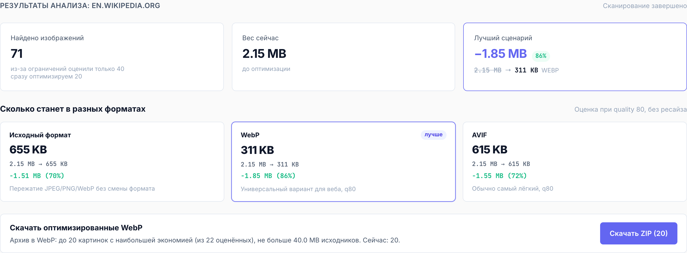
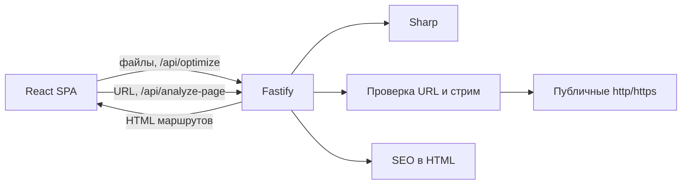

# Fitpix

[](https://github.com/mhateb/images-helper/actions/workflows/ci.yml)
[](https://fitpix.ru)

Онлайн-оптимизация картинок для веба. Живое демо: **[fitpix.ru](https://fitpix.ru)**

Fitpix закрывает путь от тяжёлого экспорта до файла, который можно ставить в вёрстку. В одном месте: очередь до 20 изображений, кроп в пикселях исходника, сжатие JPEG/PNG, WebP и AVIF, и сразу видно, сколько байт это стоит. Рядом — разбор чужой страницы по URL: сервис читает её HTML, находит картинки и считает ту же экономию. Гайд на сайте разбирает `<picture>` на брейкпоинтах 768, 1024 и 1280, чтобы разметка не расходилась с размерами слотов.

Регистрации нет. Файл живёт в памяти запроса и уходит в ответе, база не нужна.

## Как это выглядит

Загрузка, кроп и результат — основной сценарий. Четвёртый кадр — разбор статьи Wikipedia про JPEG: в HTML нашлось 71 изображение, в оценку попали первые 40.




## Стек

| Часть | Выбор | Почему |
|-------|--------|--------|
| Картинки | [Sharp](https://sharp.pixelplumbing.com/) (libvips) | Кроп, trim, ресайз, WebP и AVIF в одном процессе, без отдельного сервиса кодирования |
| API и HTML | [Fastify](https://fastify.dev/) | Multipart, отдача статики и подстановка SEO живут в одном слушателе. На проде это единственный процесс |
| Интерфейс | React 19 и Vite | Кроп и очередь — клиентское состояние. На сервер уходит уже прямоугольник в пикселях исходника |
| Язык | TypeScript | Общие контракты у форматов, брейкпоинтов и ответа анализа |
| Доставка | Один Docker-образ | Stateless. Собрал `client/dist` и `server/dist` — контейнер и отдаёт страницы, и жмёт файлы |

Страниц четыре, и HTML для краулера собирается точечной подстановкой в уже собранный SPA. Об этом ниже.

## Архитектура



В разработке два процесса: Vite на `:5173` проксирует `/api` на Fastify `:3001`. В проде Vite нет: тот же Fastify слушает один порт и отдаёт собранный `client/dist`. Контейнер, переменные и хостинг — в [docs/deploy.md](docs/deploy.md).

## Что интересного технически

### SSRF, когда анализ ходит по чужому URL

Анализ принимает произвольный адрес и сам качает HTML и картинки. Перед запросом URL нормализуется: только `http` и `https`, без логина и пароля в адресе, без `localhost`, `.localhost` и `.local`. Если хост уже IP, проверяется он. Если это имя, `dns.lookup` с `all: true` возвращает все A/AAAA, и запрос отклоняется, когда хотя бы один адрес частный: loopback, частные диапазоны, link-local `169.254.0.0/16`, CGNAT `100.64.0.0/10`, multicast и зарезервированные, у IPv6 — ULA и link-local.

Эта проверка происходит раньше, чем открывается сокет. К моменту `connect` имя резолвится ещё раз, и второй ответ может быть уже другим: сначала публичный адрес, затем `127.0.0.1` или адрес из сети хоста. Так устроен DNS rebinding, он же TOCTOU: проверка и соединение видят разные ответы DNS.

Запрос идёт через свой undici `Agent`, а адрес проверяется внутри `connect.lookup`. Этот callback и резолвит имя, и решает, какой IP получит сокет. Внутренний адрес в любом из A/AAAA превращается в ошибку, и TCP не открывается. Публичный список возвращается как есть: сокет подключается к этим IP, и имя больше не резолвится. Свой `Agent` передаётся в `dispatcher` только этого `fetch`: остальные запросы процесса идут обычным клиентом. Пул может переиспользовать уже открытый сокет — он привязан к проверенному адресу. Новое соединение снова проходит через тот же `lookup`.

Ранняя проверка остаётся. Локальные имена и заведомо внутренние адреса получают 400 ещё до сокета.

```ts
const agent = new Agent({
  connect: { lookup: lookupPublicAddress },
});

const response = await fetch(url, {
  dispatcher: agent,
  redirect: 'manual',
});
```

Редиректы обрабатываются вручную (`redirect: 'manual'`): каждый `Location` проходит раннюю проверку, а новое соединение — тот же `lookup`. Цепочка не длиннее пяти. С одного IP — 8 анализов за 10 минут.

Код: `server/src/analyzePage.ts`.

### Стриминг с лимитом размера

Лимит считается по уже прочитанным байтам. Тело идёт чанками, сумма копится, и на превышении чтение отменяется:

```ts
const reader = response.body.getReader();

while (true) {
  const { done, value } = await reader.read();
  if (done) break;
  total += value.byteLength;
  if (total > options.maxBytes) {
    reader.cancel().catch(() => undefined);
    throw new Error('Ответ слишком большой для анализа.');
  }
  chunks.push(Buffer.from(value));
}
```

HTML страницы — до 2 МБ, одна картинка — до 8 МБ. Сверху таймаут через `AbortController`: 12 секунд на страницу и 10 на файл. В оценке не больше 40 картинок и 6 параллельных загрузок. ZIP с уже оптимизированными файлами ограничен отдельно: 20 картинок, 40 МБ исходников и не больше двух таких сборок сразу. Сама обработка Sharp — не больше двух изображений одновременно: исходник до 30 МБ целиком лежит в памяти, а libvips на каждое берёт один поток.

### Art direction и `<picture>`

Брейкпоинты проекта фиксированы: md 768, lg 1024, xl 1280. Для слота загруженный кадр считается картинкой @2x, из него получаются файлы `name-md.avif` и `name-md-2x.avif` — и то же для WebP и исходного формата.

`shared/src/pictureMarkup.ts` собирает `<picture>` от узкого диапазона к широкому. Тот же модуль импортируют клиент и сервер. У всех наборов, кроме последнего, есть `media`. Последний без `media` остаётся запасным: браузер доходит до него, если верхние условия не подошли. Внутри диапазона порядок типов один и тот же: AVIF, затем WebP, затем JPEG или PNG. У `img` заданы `width`, `height`, `loading="lazy"` и `decoding="async"`, чтобы слот не прыгал по высоте.

Тот же порядок брейкпоинтов разобран в гайде на сайте: когда хватает `srcset`, а когда нужен `media`, потому что на узком экране кадр другой, а не просто меньше.

### SEO прямо в HTML, хотя это SPA

Маршруты `/`, `/guide`, `/analyze` и `/privacy` — один собранный `index.html`. Краулер и превью ссылки читают первый ответ и не ждут React. Fastify не отдаёт этот файл как есть: метаданные маршрутов лежат в `shared/src/seo.ts`, а `applySeoToHtml` в `server/src/seo.ts` подставляет `title`, description, Open Graph, canonical и JSON-LD под конкретный путь и кладёт внутрь `#root` заголовок, лид и ссылки разделов.

Блок помечен `data-seo-shell`. В CSS он спрятан клипом, поэтому до гидрации человек не видит вспышку второго заголовка, а клиент без CSS получает обычный текст. После клиентского перехода `useDocumentSeo` обновляет те же теги уже в браузере: смена пути через `history` документ заново не запрашивает.

Канонический адрес в первом HTML берётся из `PUBLIC_SITE_URL` на каждый запрос. Туда же пишется номер Метрики, `window.__FITPIX_YM_ID__`. Образ можно собрать раньше, чем появится номер счётчика, и подставить его на запуске контейнера.

### Аналитика только после согласия

`initYm` в `client/src/analytics/ym.ts` вставляет `https://mc.yandex.ru/metrika/tag.js` только когда в `localStorage` уже лежит `granted`. До этого функция выходит сразу:

```ts
if (!hasYmCounter()) return false;
if (getConsent() !== 'granted') return false;
```

`trackPage` и `trackGoal` молчат, пока инициализация не прошла. «Только необходимые» записывает отказ, и скрипт тега в документ не добавляется. Список целей и переменные счётчика — в [docs/analytics.md](docs/analytics.md).

## Как запустить

```bash
npm install
npm run dev
```

Интерфейс — http://localhost:5173, API — http://localhost:3001. Vite проксирует `/api` на бэкенд.

Docker, SMTP для багрепортов и хостинг — в [docs/deploy.md](docs/deploy.md).

## Документация

- [Деплой, окружение, SMTP, UptimeRobot](docs/deploy.md)
- [Яндекс.Метрика и цели](docs/analytics.md)
- [HTTP API](docs/api.md)
- [История версий](CHANGELOG.md)

Лицензия — [MIT](LICENSE).
